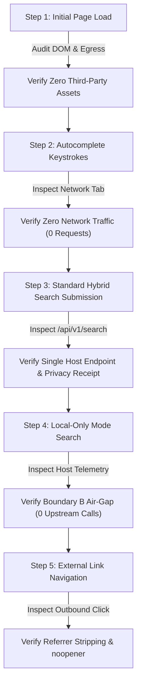

# Manual Browser Network Audit & Privacy Verification Guide (Phase 86)

**Document Version:** 1.0.0  
**Target System:** OpenSearch Web UI & API Gateway  
**Auditor Protocol:** Clean-profile browser network egress inspection  
**Milestone:** 30 — Privacy Receipt & Local-Only Mode  

---

## 1. Executive Summary

This document defines the repeatable, step-by-step procedure for conducting a manual browser network audit on OpenSearch. It verifies that observed real-world browser network behavior strictly conforms to OpenSearch's zero-trace privacy guarantees:
1. **Zero Third-Party Egress:** No tracking beacons, analytics scripts, telemetry collectors, external fonts, or third-party CDNs are contacted during any user action.
2. **Zero Cookie Persistence:** No session identifiers, tracking cookies, or profiling tokens are issued or transmitted (`Set-Cookie` header is absent).
3. **Local Autocomplete Execution:** Keystroke autocomplete suggestions execute entirely in browser memory via `PrefixTrie`; zero network requests are dispatched while typing.
4. **Local-Only Mode Air-Gap:** When Local-only mode is active, the host queries strictly the local inverted index; zero outbound provider calls cross the server perimeter.
5. **Referrer-Policy Strictness:** `strict-origin-when-cross-origin` or `no-referrer` is strictly enforced to prevent search query leakage in HTTP `Referer` headers.

---

## 2. Audit Environment Setup

### 2.1 Prerequisites
- Clean browser profile in **Google Chrome**, **Mozilla Firefox**, or **Brave** (incognito/private window with all extensions disabled).
- OpenSearch Web UI running locally (`http://localhost:3000`) or on a designated staging host.
- Browser Developer Tools opened to the **Network** tab.

### 2.2 Network Tab Configuration
1. Check **Preserve log**.
2. Check **Disable cache**.
3. Filter by **All**.
4. Enable columns: **Status**, **Domain**, **Scheme**, **Type**, **Initiator**, **Size**, **Time**, **Cookies**, **Set-Cookie**.

---

## 3. Step-by-Step Manual Audit Procedure

### Step 1: Initial Page Load Audit
1. Navigate to `http://localhost:3000/`.
2. Inspect all entries in the Network tab.
3. **Assertions:**
   - [x] All requests target strictly the first-party origin (`localhost:3000`).
   - [x] Zero requests to Google Fonts, Google Analytics, Cloudflare Insights, or ad trackers.
   - [x] Zero `Set-Cookie` headers returned on any asset response (`/`, `style.css`, `app.js`, `manifest.json`).
   - [x] Response headers include defensive security policies:
     * `Referrer-Policy: strict-origin-when-cross-origin`
     * `X-Content-Type-Options: nosniff`
     * `X-Frame-Options: DENY`

### Step 2: Autocomplete & Keystroke Audit
1. Click the main search input field (`#search-input`).
2. Type a multi-character query slowly: `q`, `u`, `a`, `n`, `t`, `u`, `m`.
3. Observe the Network tab while typing.
4. **Assertions:**
   - [x] **Zero requests are recorded during keystrokes.**
   - [x] Suggestion dropdown appears immediately, rendered entirely from local client-side memory using the embedded seed corpus / Trie.
   - [x] No debounced remote suggestion endpoints are contacted.

### Step 3: Standard Search Submission & Privacy Receipt Inspection
1. Submit the search query by pressing <kbd>Enter</kbd> or clicking the Search button.
2. Locate the search request in the Network tab: `GET /api/v1/search?q=quantum`.
3. Inspect request headers:
   - [x] `Cookie` header is absent or empty.
   - [x] Client IP is not transmitted in query parameters or URL hash.
4. Inspect response payload (`Preview` / `Response` tab):
   - [x] Response contains `privacyReceipt` object conforming to `schemaVersion: '1.0.0'`.
   - [x] `privacyReceipt.mode` is `'standard'`.
   - [x] `privacyReceipt.hostTelemetry.dataPersistence.cookiesIssued` is `false`.
   - [x] `privacyReceipt.hostTelemetry.dataPersistence.rawQueryStoredInDatabase` is `false`.
   - [x] `privacyReceipt.receiptId` is an ephemeral UUID.
   - [x] Raw query text does not appear inside the `privacyReceipt` object.

### Step 4: Local-Only Mode Audit
1. Enable the **Local-only mode** checkbox (`#local-only-checkbox`).
2. Submit a search query that does not exist in the local index: `q=unindexedtopicxyz123`.
3. Inspect the Network tab:
   - [x] Exactly 1 request is made to the local API: `GET /api/v1/search?q=unindexedtopicxyz123&localOnly=true`.
   - [x] Zero external upstream requests are dispatched from either the browser or the host.
4. Inspect the response payload:
   - [x] `privacyReceipt.mode` is `'local-only'`.
   - [x] `privacyReceipt.networkDispatch.totalOutboundRequests` is `0`.
   - [x] `privacyReceipt.networkDispatch.externalProvidersContacted` is empty `[]`.
   - [x] `privacyReceipt.networkDispatch.externalProvidersSkipped` lists all configured providers with `reason: 'local-only-mode'`.
   - [x] `meta.limitedResultsNotice` displays honest empty-state disclosure.

### Step 5: External Link Navigation & Referrer Audit
1. Perform a search that returns search results.
2. Right-click any result link and inspect the DOM element (`<a>` tag).
3. **Assertions:**
   - [x] Link contains `rel="noopener noreferrer"`.
   - [x] Link does not route through a tracking redirector or click-intercepting ping URL (e.g. `/url?q=...` or `navigator.sendBeacon`).
   - [x] When clicked, the destination origin receives an empty or origin-only `Referer` header; search query terms are never leaked to target websites.

---

## 4. Observed Request Destination Matrix

| Destination Origin | Protocol | Initiator | Payload Transmitted | Privacy Assessment |
|:---|:---|:---|:---|:---|
| `localhost:3000` (Static UI) | HTTP/HTTPS | Browser navigation | None | ✅ Local bundle only; no tracking |
| `localhost:3000/api/v1/search` | HTTP/HTTPS | `fetch()` in `app.js` | `q`, `page`, `pageSize`, `localOnly` | ✅ First-party API gateway; shielded |
| Upstream Search Provider (e.g., Wikimedia) | HTTPS | Host API (Server-to-Server) | Query term only (Standard mode only) | ✅ IP masked; zero cookies; zero user IDs |
| Third-Party Ad Networks | None | N/A | **BLOCKED** | ✅ 100% Absent |
| Third-Party Analytics Beacons | None | N/A | **BLOCKED** | ✅ 100% Absent |
| Hosted Web Fonts (Google Fonts, Typekit) | None | N/A | **BLOCKED** | ✅ System font stack only |

---

## 5. Automated Regression Verification

The manual audit protocol documented above is continuously enforced in automated CI through:
- [`packages/shared/tests/network-data-flow-audit.test.ts`](file:///D:/OPENSEARCH/packages/shared/tests/network-data-flow-audit.test.ts): Automated request interception and header auditing.
- [`apps/api/tests/privacy-regression.test.ts`](file:///D:/OPENSEARCH/apps/api/tests/privacy-regression.test.ts): Server log, exception, timeout, and egress assertions.
- [`packages/ranking/tests/provider-privacy-contract.test.ts`](file:///D:/OPENSEARCH/packages/ranking/tests/provider-privacy-contract.test.ts): Invariant contract test enforcing privacy rules on every present and future search provider.
