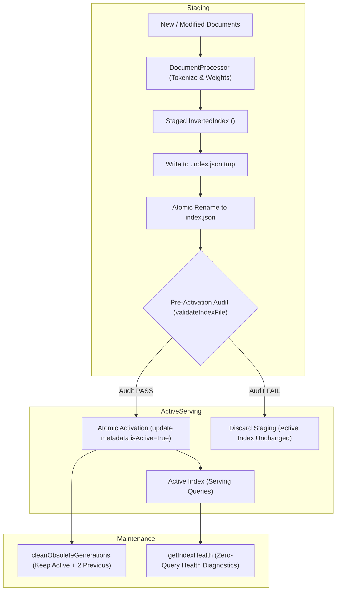

# OpenSearch — Index Lifecycle, Incremental Indexing & Safe Recovery

**Version:** 1.5.0  
**Milestone:** 28 — Index Storage and Dataset Growth  
**Phase:** 76 — Incremental indexing and safe recovery  

---

## 1. Architectural Overview

OpenSearch maintains an inverted index partitioned into versioned, immutable **generations** stored in isolated directories under `<storageDir>/index/builds/<buildId>`. 

Rather than mutating a running index directly in-place or relying on destructive updates, OpenSearch enforces three core architectural invariants:
1. **Isolated Staging**: New index generations are compiled in a separate staging directory.
2. **Pre-Activation Audit**: Staged generations must pass strict structural, checksum, and schema validation before promotion.
3. **Atomic Publication**: Activation swaps the active pointer in storage only after the new generation is completely written and verified on disk.



---

## 2. Idempotent Document Operations & Fingerprint Tracking

### 2.1 Content Fingerprinting
To prevent redundant re-indexing and expensive text reprocessing, OpenSearch computes a deterministic SHA-256 content fingerprint for each document:

$$\text{Fingerprint} = \text{SHA-256}\Big(\text{normalize}(\text{title}) + \text{normalize}(\text{headings}) + \text{normalize}(\text{description}) + \text{normalize}(\text{bodyText})\Big)$$

If a document already supplies a verified `contentHash` at ingestion time, that hash is utilized directly as the fingerprint.

### 2.2 Idempotent Add / Update (`indexDocument`)
When `indexDocument(docRecord)` is invoked:
1. The engine checks if `docRecord.id` already exists in the active in-memory index metadata.
2. The current document fingerprint is compared against `existingMeta.fingerprint`.
3. **If unchanged**: Processing is skipped immediately (`action: 'skipped'`). No tokens are parsed, and no disk writes occur.
4. **If changed or new**: 
   - Previous postings for `docRecord.id` are purged from the dictionary.
   - The document is re-tokenized and weighted.
   - New postings are inserted.
   - The active index is saved atomically (`.tmp` $\to$ `rename`).
   - The document record in storage is marked `INDEXED`.
   - Returns `action: 'updated'` or `action: 'indexed'`.

### 2.3 Idempotent Delete (`deleteDocument`)
When `deleteDocument(documentId)` is invoked:
1. If `documentId` is not in the active index, the operation returns `false` (no-op).
2. All postings referencing `documentId` are excised from dictionary posting lists.
3. Terms whose document frequency drops to 0 are pruned from the dictionary to avoid memory leaks.
4. The active index is saved atomically.
5. In storage, the document is marked `NOT_INDEXED`.

---

## 3. Atomic Publication & Crash Invariants

### 3.1 Two-Phase Staging and Write
Index persistence in `InvertedIndex.save()` always writes to a temporary file before renaming:
```
1. Write JSON payload to:  <indexDir>/.index.json.tmp
2. Flush and close file descriptor.
3. Atomic OS rename to:   <indexDir>/index.json
```
If power is lost or the Node.js process crashes mid-write:
- Only `<indexDir>/.index.json.tmp` is partial or corrupt.
- The existing `<indexDir>/index.json` remains completely intact and valid.

### 3.2 Interrupted Builds
Full and incremental builds operate in an isolated staging folder:
`<indexDir>/builds/<newBuildId>`

If a rebuild encounters an error, timeout, or uncaught exception:
1. The active index continues serving search queries uninterrupted.
2. The staging directory `<indexDir>/builds/<newBuildId>` is purged.
3. The storage metadata for `newBuildId` is marked `status: 'failed'`.
4. No partially indexed state ever replaces valid search data.

---

## 4. Generation Retention and Pruning Rules

Over time, repeated rebuilds create multiple generations. OpenSearch implements an automated cleanup engine (`cleanObsoleteGenerations`):

### 4.1 Retention Rules
1. **Active Generation Invariant**: The active generation (`isActive: true`) is **never pruned**, under any circumstance.
2. **Rollback Quota (`maxRetained`)**: By default, OpenSearch retains the active generation plus the **2 most recent successful generations** (total of 3 retained). This ensures immediate rollback capability if an issue is detected post-deployment.
3. **Pruning Obsolete Generations**: Older ready generations beyond the quota are deleted from disk (`fs.rmSync`) and marked `status: 'stale'` in storage metadata.
4. **Pruning Failed Staging**: Interrupted or failed build directories (`status: 'failed'`) are pruned immediately to reclaim disk space.

---

## 5. Safe Health Monitoring (Zero Content Leakage)

The `getIndexHealth()` method provides comprehensive observability for operations without violating privacy boundaries.

### 5.1 Privacy Contract
- **Never includes search queries.**
- **Never includes dictionary terms or vocabulary.**
- **Never includes document titles, URLs, or body text.**
- **Only includes operational counts, byte sizes, integrity booleans, and ISO timestamps.**

### 5.2 Health Status Model
| Health Status | Definition |
|---|---|
| `healthy` | Active index exists, passes integrity audit, and no pending/stale documents await indexing. |
| `degraded` | Active index is online and serving queries, but unindexed pending or stale documents exist in storage. |
| `rebuilding` | A rebuild is actively in-flight in staging. |
| `corrupt` | Active index file failed checksum or schema validation. Automatic recovery required. |
| `uninitialized`| No active index has been built yet. |

### 5.3 Diagnostic Payload Example
```json
{
  "status": "healthy",
  "schemaVersion": 1,
  "activeGeneration": {
    "buildId": "7a344131-6ec0-4f24-9bfc-ab8729507f17",
    "version": "1.0.0",
    "documentCount": 1000,
    "termCount": 14205,
    "avgDocumentLength": 184.2,
    "totalPostings": 45102,
    "builtAt": "2026-10-25T12:00:00.000Z",
    "indexPath": "/data/index/builds/7a344131-6ec0-4f24-9bfc-ab8729507f17",
    "integrityValid": true,
    "fileSizeBytes": 1249102
  },
  "generations": {
    "totalGenerations": 3,
    "retainedCount": 3,
    "oldestGenerationAt": "2026-10-25T08:00:00.000Z",
    "newestGenerationAt": "2026-10-25T12:00:00.000Z"
  },
  "pendingDocuments": {
    "pendingCount": 0,
    "staleCount": 0,
    "indexedCount": 1000,
    "needsReindex": false
  },
  "lastCheckedAt": "2026-10-25T12:01:00.000Z"
}
```

---

## 6. Self-Healing & Automatic Recovery Workflow

When the system boots or reloads the active index via `loadActiveIndex()`:
1. The active metadata is queried from storage.
2. If `activeMeta.indexPath` is missing or fails `validateIndexFile()`:
   - An error is logged at `ERROR` level.
   - The corrupt generation is marked `status: 'failed'` in storage.
   - The engine automatically initiates an emergency rebuild from the durable document repository (`build({ mode: 'full' })`).
   - The new healthy generation is staged, validated, and promoted atomically.
