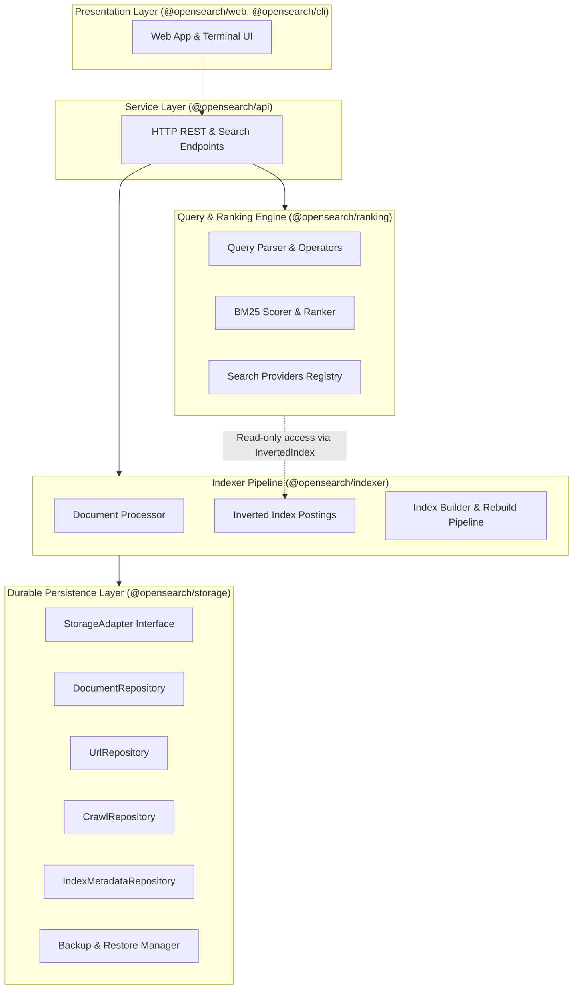

# Storage Architecture, Persistence & Platform Evaluation

**Document Version:** 1.0.0  
**Phase:** Phase 74 (Milestone 28 — Index Storage and Dataset Growth)  
**Status:** Canonical Storage Blueprint  
**Last Updated:** October 2026  

---

## 1. Architectural Principles & Layer Separation

OpenSearch strictly separates persistent state operations from retrieval ranking, query processing, and presentation layers:



### Invariants:
1. **Zero Storage Coupling in Ranking:** The ranking engine (`@opensearch/ranking`) operates strictly against in-memory or memory-mapped index structures (`InvertedIndex`, `ScoredDocument`), never issuing disk I/O or database mutations.
2. **Zero Raw Query Logging:** User search queries are processed ephemerally in-memory. No query history, user search strings, or session tracking are ever persisted to disk.
3. **Pluggable Repository Abstractions:** All business logic references typed interfaces (`StorageAdapter`, `DocumentRepository`, `UrlRepository`, `CrawlRepository`, `IndexMetadataRepository`). Concrete engines (JSON, SQLite) remain isolated behind factories.

---

## 2. Storage Backend Evaluation: JSON Store vs. SQLite vs. Alternatives

Before expanding dataset size beyond 10,000+ documents, we conducted a rigorous comparative evaluation of potential persistence backends for OpenSearch:

| Evaluation Dimension | Atomic JSON File Store (Current) | SQLite (e.g. `better-sqlite3` / `node:sqlite`) | Embedded Key-Value (LevelDB / LMDB) | Client-Server RDBMS (PostgreSQL) |
| :--- | :--- | :--- | :--- | :--- |
| **Zero-Dependency Portability** | **Exceptional** (100% pure TypeScript/Node.js; zero native C/C++ builds) | **Moderate to Poor** (Requires native binary compilation; frequent `node-gyp` Windows/CI failures) | **Poor** (C++ binary compilation required for bindings) | **Poor** (Requires external daemon, network credentials, separate process) |
| **Dataset Capacity** | Optimal up to ~50,000 documents (~100MB JSON) | Optimal up to 1,000,000+ documents (GB scale) | High throughput for simple key lookups; complex scans awkward | Massive (Multi-TB scale) |
| **Write Atomicity & Durability** | Atomic via `.tmp` file write + atomic `renameSync` | Full ACID transactions with WAL (Write-Ahead Logging) | ACID transactions with B-Tree / LSM-tree | Full multi-version concurrency (MVCC) ACID |
| **Query Flexibility** | Sequential scans + in-memory Map indices | Rich relational SQL, B-tree secondary indexes, joins | Point lookups & range scans only | Advanced SQL, full relational queries |
| **Cold Startup Latency** | **Fast** (Single read + parse per collection) | **Instant** (Zero in-memory hydration required) | **Instant** (Zero hydration) | High (Network TCP + auth handshake) |
| **Serverless Compatibility** | High (Self-contained, read-only bundles supported) | High (Single read-only `.db` file bundle supported) | Moderate | Requires pooling / proxy (e.g. Supabase, Neon) |

### Formal Decision & Migration Path:
1. **Primary Backend for v1.5:** Retain and fortify the **Atomic JSON File Store** (`JsonStorageAdapter`):
   - Eliminates all native C/C++ build dependencies, ensuring instant, reproducible `npm install` on Windows, macOS, Linux, and Alpine Docker containers.
   - Fortified in Phase 74 with snapshot backups (`manifest.json` with SHA-256 checksums), validated atomic restores, and filesystem corruption audits.
2. **Pluggable Architecture Maintained:** The `StorageAdapter` interface allows introducing a `SqliteStorageAdapter` or `PostgresStorageAdapter` seamlessly whenever a single node exceeds 100,000 documents without refactoring ranking, indexing, or API services.

---

## 3. Configurable Storage & Directory Hierarchy

OpenSearch persistence directories are completely configurable via environment variables and typed application configuration:

| Configuration Key | Environment Variable | Default Path | Purpose |
| :--- | :--- | :--- | :--- |
| `config.storage.storageDir` | `STORAGE_DIR` | `./data/storage` | Document records, crawl events, URL frontier, index metadata |
| `config.storage.indexDir` | `INDEX_DIR` | `./data/index` | Active and staging inverted index postings and term dictionaries |
| `config.crawler.dataDir` | `CRAWLER_DATA_DIR` | `./data/crawler` | Robots.txt cache, crawl frontier persistent queue |
| Root Data Override | `DATA_DIR` | `./data` | Base directory if specific sub-directories are omitted |

### Persistent Directory Layout:
```text
data/
├── storage/
│   ├── documents.json       # DocumentRepository (title, body, metadata)
│   ├── urls.json            # UrlRepository (crawl state, URL hashes)
│   ├── crawls.json          # CrawlRepository (crawl attempt logs)
│   └── index-metadata.json  # IndexMetadataRepository (builds & active pointers)
├── index/
│   ├── index-data.json      # Current active InvertedIndex (schemaVersion: 1)
│   └── builds/              # Staging directory for new index generations
│       └── <buildId>/       # Isolated un-promoted build artifacts
└── backups/                 # Snapshot archives
    └── backup-<timestamp>/  # Complete backup snapshot with manifest.json
```

---

## 4. Backup, Restore, and Corruption Recovery

### 4.1. Backup Creation Workflow
When `storage.backup(destinationDir)` or `createStorageBackup()` is executed:
1. Source storage directory is locked against conflicting writes.
2. Each persistent collection (`documents.json`, `urls.json`, `crawls.json`, `index-metadata.json`) is read and copied to the destination.
3. Individual SHA-256 file checksums and record counts are calculated.
4. A self-contained `manifest.json` is generated containing metadata, engine version, collection metrics, and an overall manifest digest.

### 4.2. Validated Restore Workflow
When `storage.restore(sourceBackupDir)` or `restoreStorageBackup()` is executed:
1. **Pre-flight Audit:** Reads `manifest.json` and verifies SHA-256 checksums for every backup file on disk. If any file is corrupt or tampered with, restore immediately aborts before modifying the target storage.
2. **Atomic Restoration:** Files are copied to target with `.tmp` suffixes and atomically renamed to prevent partial writes.
3. **Live Re-Hydration:** Memory stores (`_documents`, `_urls`, `_crawls`, `_indexMetadata`) are dynamically re-loaded from disk so the active application instantly reflects restored data without a server restart.

### 4.3. Corruption Detection & Recovery
`storage.verifyIntegrity()` inspects every collection file for:
- 0-byte truncated files.
- JSON syntax errors or partial byte streams.
- Structural schema violations (`records` map missing).
- Dangling `.tmp` files from crashed processes.

---

## 5. Deployment Platform Persistence Analysis

| Deployment Target | Persistence Mechanism | Status | Notes |
| :--- | :--- | :---: | :--- |
| **Self-Hosted Node.js / VPS** | Standard local filesystem (`./data`) | **Fully Supported** | Data survives application restarts, system reboots, and updates. |
| **Docker / Containerized** | Volume mount (e.g. `-v opensearch_data:/app/data`) | **Fully Supported** | Preserves all storage and indexes across container rebuilds and image updates. |
| **Kubernetes** | `PersistentVolumeClaim` (PVC) mounted to `/data` | **Fully Supported** | Standard stateful storage pattern. |
| **Serverless (Vercel / AWS Lambda)** | Read-only ephemeral filesystem (`/tmp` ephemeral) | **Read-Only / External** | **Critical Caveat:** Local `/tmp` is destroyed across cold starts. Serverless search instances must bundle a pre-built static index or mount persistent cloud object storage (e.g., S3/R2). Durable crawl operations must not rely on serverless `/tmp`. |

---

## 6. Privacy Verification: Query Non-Persistence

OpenSearch adheres strictly to its Zero-Trace Privacy invariant:
- The storage layer schema defines **zero** tables, files, or fields for recording user queries.
- Query tokens are tokenized, processed, and evaluated entirely in transient volatile memory.
- Responses contain zero persistent tracking IDs, cookies, or database writebacks.
- Verified in `apps/api/tests/security-audit.test.ts` and `packages/storage/tests/document-repository.test.ts`.
