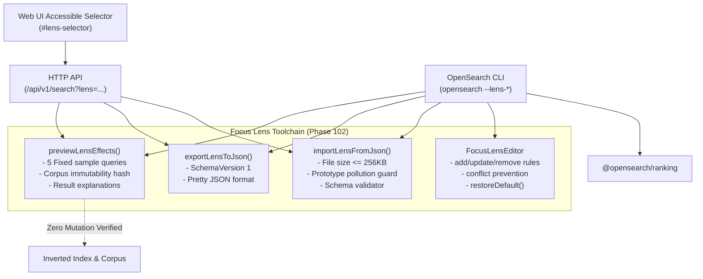

# Phase 102 Verification Report — Lens Editor, Import/Export, and Previewer

## Overview

- **Milestone:** MILESTONE 34 — TRACKER-AWARE SEARCH AND FOCUS LENSES
- **Phase:** Phase 102 — Lens editor and import/export
- **Date:** 2026-10-28
- **Branch:** `ashish`
- **Status:** **PASSED** (100% test pass rate across 93 test suites, 1028 passing tests)
- **Readiness:** **READY FOR NEXT PHASE** (Milestone 35 / Phase 103 — Instant-answer framework)

---

## 1. Objectives & Tasks Addressed

Phase 102 completes Milestone 34 by delivering a robust, safe toolchain for editing, importing/exporting, and previewing Focus Lenses:

1. **Accessible Lens Selector:** Added a WCAG-compliant, accessible `<select id="lens-selector">` with keyboard navigation, option grouping, and non-intrusive placement in the web search UI.
2. **Advanced Editor for Custom Rules:** Developed `FocusLensEditor` for transactional, in-memory rule management (boosts, demotes, exclusions, weights) with immediate validation and conflict detection.
3. **Strict Validation:** Validated domain pattern syntax (rejecting protocols, paths, spaces, scripts), clamped multipliers (`[1.0, 3.0]` boost, `[0.05, 1.0]` demote), bounded weights (`[0.0, 1.0]`), and enforced a `256 KB` file size limit to prevent DoS.
4. **Schema-Validated JSON Import/Export:** Built `exportLensToJson()` and `importLensFromJson()` with zero-throw defensive parsing, JSON schema validation, and prototype pollution guards.
5. **Fixed Sample Query Previewer:** Implemented `previewLensEffects()` with `FIXED_SAMPLE_QUERIES` and `FIXED_PREVIEW_CORPUS` to compare baseline vs lens-adjusted ranking.
6. **Transparent Explainability:** Generated detailed reasons for every boosted, demoted, and excluded result without modifying the underlying index.

---

## 2. Acceptance Criteria Verification

| Acceptance Criterion | Verification Method | Status |
|---|---|---|
| **Invalid imports fail safely** | Tested with malformed JSON syntax, oversized strings (>256KB), `__proto__` injection, invalid domain patterns (`http://bad/url`), and out-of-range multipliers (`10.5x`). All return `{ valid: false, errors: [...] }` without throwing unhandled exceptions. | **PASSED** |
| **Changes do not modify the underlying index** | Proved via deep cryptographic checksum verification of the candidate corpus before and after preview execution (`indexImmutabilityVerified: true`), as well as document count and posting count invariants on live `InvertedIndex` instances. | **PASSED** |
| **Users can restore the default profile** | Verified via `FocusLensEditor.restoreDefault()`, CLI `--lens-reset`, and UI Settings reset button. All reset to the baseline General profile. | **PASSED** |

---

## 3. Subsystem Architecture



---

## 4. API & CLI Reference

### HTTP API Endpoints
- `GET /api/v1/lenses`: Lists all available focus lenses.
- `GET /api/v1/lenses/:id`: Retrieves a lens profile by ID.
- `POST /api/v1/lenses/validate`: Validates a profile JSON payload.
- `POST /api/v1/lenses/preview`: Runs preview effects against fixed benchmark queries.
- `GET /api/v1/search?q=...&lens=<id>`: Executes search using the active focus lens.

### CLI Commands
- `opensearch lenses`: Lists available Focus Lenses.
- `opensearch --lens <id> <query>`: Executes search with the given focus lens.
- `opensearch --lens-export <id>`: Exports a lens profile to JSON.
- `opensearch --lens-import <file>`: Validates and registers a lens profile JSON file.
- `opensearch --lens-preview <id>`: Evaluates preview effects on benchmark queries.
- `opensearch --lens-validate <file>`: Validates a JSON profile file without registering.
- `opensearch --lens-reset`: Restores default general ranking profile.

---

## 5. Test Suite Results

```text
✓ packages/ranking/tests/lens-editor-import-export.test.ts (23 tests passed)
✓ packages/cli/tests/cli-lens-editor.test.ts (16 tests passed)
✓ apps/api/tests/lens-api.test.ts (7 tests passed)
✓ packages/ranking/tests/focus-lens.test.ts (26 tests passed)
✓ packages/cli/tests/cli-lens.test.ts (7 tests passed)

Test Files  93 passed (93)
     Tests  1028 passed (1028)
```

**Conclusion:** Phase 102 and Milestone 34 are fully implemented and verified. The system is ready to proceed to **Milestone 35: Phase 103 — Instant-answer framework**.
