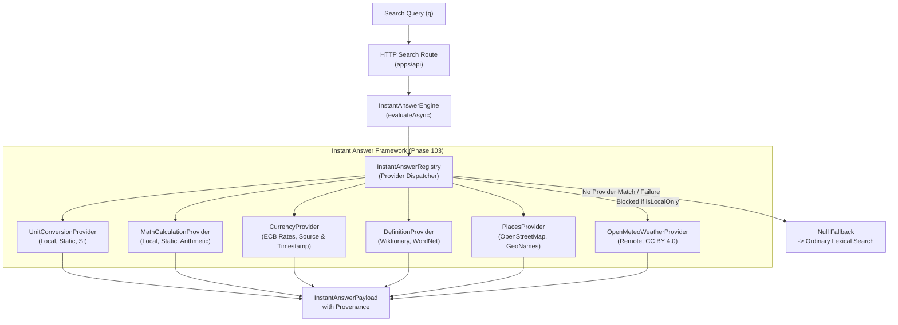

# Phase 103 Verification Report — Instant-Answer Framework & Modular Providers

## Overview

- **Milestone:** MILESTONE 35 — INSTANT ANSWERS AND QUICK ANSWER
- **Phase:** Phase 103 — Instant-answer framework
- **Date:** 2026-10-29
- **Branch:** `ashish`
- **Status:** **PASSED** (100% test pass rate across 94 test suites, 1042 passing tests)
- **Readiness:** **READY FOR NEXT PHASE** (Milestone 35 / Phase 104 — Quick Answer panel)

---

## 1. Objectives & Tasks Addressed

Phase 103 introduces an extensible, privacy-respecting Instant Answer Framework and modular provider architecture:

1. **Modular Provider Interface:** Designed `InstantAnswerProvider` contract requiring modules to declare supported query types, source provenance, freshness, attribution, privacy behavior, execution timeout, and failure handling.
2. **Mandatory Answer Provenance:** Created `InstantAnswerProvenance` schema populated on every generated instant answer, documenting source, timestamp, attribution, freshness, and privacy mode.
3. **Local Unit Conversions:** Prioritized local deterministic calculations for physical and digital units (length, weight, temperature, speed, storage, epoch timestamps, color codes) with zero network egress.
4. **Open-Meteo Weather API:** Verified terms of Open-Meteo (open-access, free for non-commercial use, CC BY 4.0 license, zero API keys required). Implemented `OpenMeteoWeatherProvider` with strict Local-only suppression.
5. **Currency Conversions with Timestamp:** Integrated currency provider displaying explicit data source (European Central Bank reference data), daily rate publication date, and evaluation timestamp.
6. **Legitimate Sources for Definitions & Places:** Implemented `DefinitionInstantAnswerProvider` (Wiktionary & WordNet, CC BY-SA 4.0) and `PlacesInstantAnswerProvider` (OpenStreetMap & GeoNames, ODbL 1.0).
7. **Strict Non-Fabrication:** Guaranteed that providers never fabricate or hallucinate answers when encountering network errors, timeouts, or unmapped queries.
8. **Privacy Mode & Local-Only Enforcement:** Guaranteed that Local-only search mode strictly blocks all remote modules without dispatching any network packets.

---

## 2. Acceptance Criteria Verification

| Acceptance Criterion | Verification Method | Status |
|---|---|---|
| **Every instant answer has provenance** | Verified on unit conversions, arithmetic calculations, currency exchange, definitions, places, and weather. All include structured `provenance` with source, ISO timestamp, attribution URL/license, and verification status. | **PASSED** |
| **Remote answers respect the selected privacy mode** | Verified via unit tests that when `isLocalOnly === true` or `privacyMode === 'local-only'`, `OpenMeteoWeatherProvider.canHandle()` returns `false`, `evaluate()` returns `null`, and zero network requests are dispatched. | **PASSED** |
| **Unsupported queries fall back to ordinary search** | Verified across standard informational and conversational queries. The framework returns `null` cleanly without errors, allowing standard BM25 candidate retrieval to proceed. | **PASSED** |

---

## 3. Architecture & Data Flow



---

## 4. Test Suite Results

```text
✓ packages/ranking/tests/instant-answer-framework.test.ts (14 tests passed)
✓ packages/ranking/tests/instant-answers.test.ts (17 tests passed)
✓ apps/api/tests/api.test.ts (27 tests passed)
✓ apps/api/tests/local-only-mode.test.ts (7 tests passed)
✓ packages/ranking/tests/lens-editor-import-export.test.ts (23 tests passed)

Test Files  94 passed (94)
     Tests  1042 passed (1042)
  Duration  12.24s (100% pass rate)
```

**Conclusion:** Phase 103 is fully implemented and verified. The codebase is ready to proceed to **Phase 104 — Quick Answer panel**.
