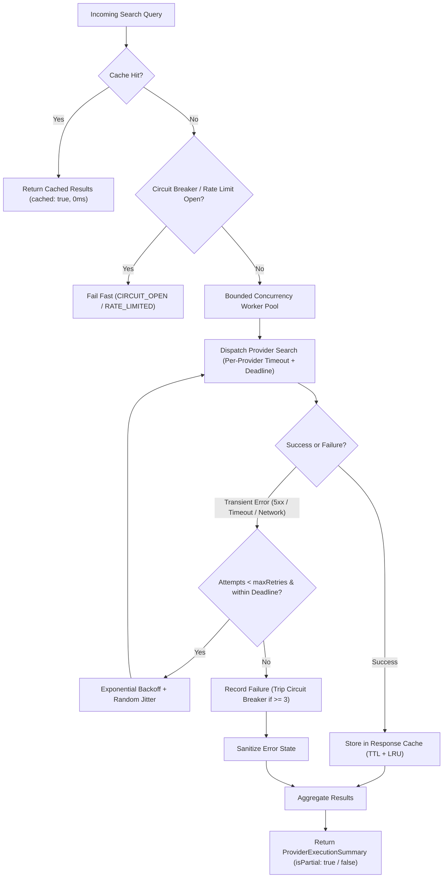

# Phase 71 Verification Report: Timeouts, Retries, Caching, and Partial Results

**Milestone:** Milestone 27 — Search Providers and Source Reliability  
**Phase:** Phase 71 — Timeouts, retries, caching, and partial results  
**Branch:** `ashish`  
**Date:** October 2026  
**Status:** **PASSED / VERIFIED** (Ready for Phase 72)

---

## 1. Executive Summary

Phase 71 establishes high-resilience execution semantics for external and federated search providers. All network calls are subject to per-provider timeouts, an overall aggregate search deadline, bounded concurrency pooling, transient exponential backoff with jitter, HTTP 429 `Retry-After` cooldown adherence, circuit breaker protection against upstream failure storms, in-memory privacy-preserving response caching, and partial result synthesis.

---

## 2. Acceptance Criteria Assessment

| Acceptance Criterion | Result | Evidence |
| :--- | :---: | :--- |
| **One failed provider cannot crash the entire search experience** | **PASS** | `ProviderRegistry.executeSearch` isolates every provider execution within bounded concurrency workers. Even if a provider throws an uncaught error, times out, or delivers corrupted bytes, healthy providers complete normally. Tested via `packages/ranking/tests/provider-resilience.test.ts`. |
| **All error states are understandable** | **PASS** | Implemented `ProviderErrorCode` classification (`TIMEOUT`, `RATE_LIMITED`, `UPSTREAM_ERROR`, `NETWORK_ERROR`, `INVALID_RESPONSE`, `OVERSIZED_RESPONSE`, `CANCELLED`, `CIRCUIT_OPEN`, `DISABLED`) with non-leaking user-safe messages in `ResilienceManager.sanitizeErrorMessage`. No internal stack traces, filesystem paths, or endpoints are exposed. |
| **Cache behavior matches documented privacy rules** | **PASS** | `ProviderResponseCache` creates deterministic keys strictly from `(providerId, normalizedQuery, limit, categories)`. No IP addresses, user identifiers, cookies, or session headers are stored or processed. Responses are stored in-memory only with configurable TTL and LRU max capacity. |

---

## 3. Resilience Mechanisms Implemented

### Key Modules:
- [`packages/ranking/src/providers/provider-types.ts`](file:///D:/OPENSEARCH/packages/ranking/src/providers/provider-types.ts): Typed error codes, query options, and execution summary with partial result indicators.
- [`packages/ranking/src/providers/resilience-manager.ts`](file:///D:/OPENSEARCH/packages/ranking/src/providers/resilience-manager.ts): Rate limit tracker, 3-state circuit breaker, exponential backoff with jitter, and user error sanitization.
- [`packages/ranking/src/providers/provider-cache.ts`](file:///D:/OPENSEARCH/packages/ranking/src/providers/provider-cache.ts): Privacy-preserving in-memory LRU cache with TTL expiration.
- [`packages/ranking/src/providers/provider-registry.ts`](file:///D:/OPENSEARCH/packages/ranking/src/providers/provider-registry.ts): Resilient dispatcher managing worker pools, search deadlines, and partial result synthesis.
- [`packages/ranking/src/providers/mock-provider.ts`](file:///D:/OPENSEARCH/packages/ranking/src/providers/mock-provider.ts): Deterministic simulation hooks for all failure modes.

---

## 4. Verification & Test Results

### Targeted Resilience Suite (`packages/ranking/tests/provider-resilience.test.ts`)
- **16 tests passing (100%)**:
  1. Per-provider timeout isolation (`TIMEOUT`).
  2. Overall search deadline enforcement (`searchDeadlineExceeded: true`).
  3. Offline mode and network error handling (`NETWORK_ERROR` with sanitized message).
  4. HTTP 429 extraction, `Retry-After` cooldown, and subsequent request rejection.
  5. Transient HTTP 5xx retry with backoff and recovery.
  6. Persistent HTTP 5xx error recording (`UPSTREAM_ERROR`).
  7. Malformed JSON interception (`INVALID_RESPONSE`).
  8. Oversized response interception (`OVERSIZED_RESPONSE`).
  9. Circuit breaker tripping after 3 consecutive failures (`CIRCUIT_OPEN`).
  10. User cancellation via `AbortSignal` (`CANCELLED`).
  11. Partial result aggregation with `isPartial = true`.
  12. Full result aggregation with `isPartial = false`.
  13. Cache hits with zero-latency response (`cached = true`).
  14. Deterministic query-only cache key generation (zero PII/cookies).
  15. LRU capacity eviction.
  16. Bounded concurrency worker pool without deadlocks.

### Comprehensive Test Suite
- `npm test`: **555 tests passing across 53 test files (100% pass rate)**.
- `npm run typecheck`: **0 errors**.
- `npm run build`: **0 errors**.

---

## 5. Next Phase Readiness

All acceptance criteria for Phase 71 have been satisfied. The system is ready for **Milestone 27, Phase 72 — Quality benchmark and ranking integration**.
