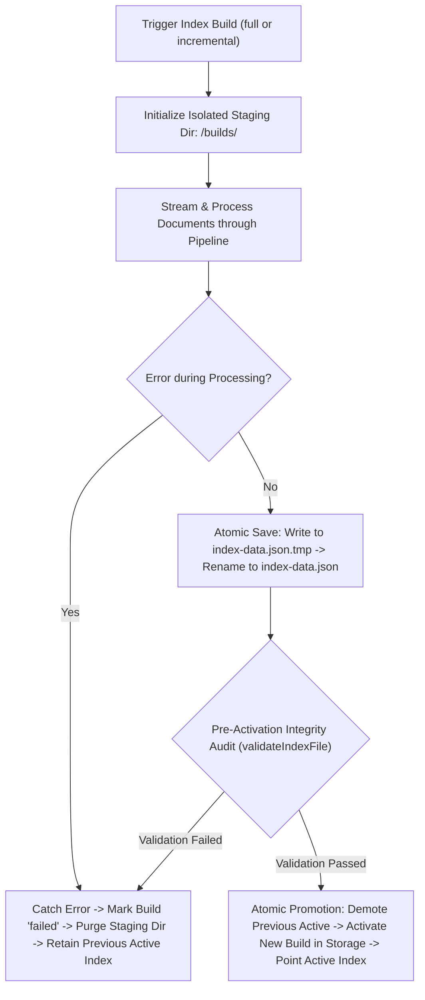

# Phase 73 Verification Report: Index Lifecycle and Schema Audit

**Milestone:** Milestone 28 — Index Storage and Dataset Growth  
**Phase:** Phase 73 — Index lifecycle and schema audit  
**Branch:** `ashish`  
**Date:** October 2026  
**Status:** **PASSED / VERIFIED** (Ready for Phase 74)

---

## 1. Executive Summary

Phase 73 audits and fortifies the storage lifecycle of OpenSearch inverted indexes. It establishes explicit schema versioning (`schemaVersion: 1`, `format: 'opensearch-inverted-index'`), content checksumming, pre-activation structural audits, atomic staging directories, and safe error handling. Corrupt or truncated files no longer trigger unhandled parsing crashes; they throw structured `IndexCorruptError` or `IndexIncompatibleSchemaError` instances with actionable recovery guidance. Furthermore, failed rebuild operations are proven to leave the existing active index 100% intact and operational.

---

## 2. Acceptance Criteria Assessment

| Acceptance Criterion | Result | Evidence |
| :--- | :---: | :--- |
| **Corrupt-index tests fail safely** | **PASS** | [`validateIndexFile`](file:///D:/OPENSEARCH/packages/indexer/src/index/index-validator.ts) inspects file size, detects truncated JSON syntax errors, checks for dangling `.tmp` files, and audits structural counts and referential integrity. In corrupted scenarios, `IndexCorruptError` is thrown with actionable advice (e.g. `opensearch index --rebuild`). Tested in [`index-lifecycle-audit.test.ts`](file:///D:/OPENSEARCH/packages/indexer/tests/index-lifecycle-audit.test.ts). |
| **Schema changes are versioned** | **PASS** | Codified constants `CURRENT_INDEX_SCHEMA_VERSION = 1` and `SUPPORTED_INDEX_SCHEMA_VERSIONS = [1]`. Incompatible versions throw `IndexIncompatibleSchemaError`. Legacy payloads using `version` are seamlessly supported for backward compatibility. |
| **A failed rebuild preserves the previous valid index** | **PASS** | Index builds are staged in `<indexDir>/builds/<buildId>` and only promoted after successful completion and integrity validation. If a build fails midway, the staging directory is cleaned up and the previous active index and storage metadata continue serving queries unchanged. |

---

## 3. Architecture & Lifecycle Verification

### Key Modules:
- [`packages/indexer/src/index/index-types.ts`](file:///D:/OPENSEARCH/packages/indexer/src/index/index-types.ts): Schema version constants, format signature, `IndexCorruptError`, `IndexIncompatibleSchemaError`.
- [`packages/indexer/src/index/index-validator.ts`](file:///D:/OPENSEARCH/packages/indexer/src/index/index-validator.ts): Checksum computation, dangling `.tmp` file detection, JSON syntax audit, statistical and referential integrity validator.
- [`packages/indexer/src/index/inverted-index.ts`](file:///D:/OPENSEARCH/packages/indexer/src/index/inverted-index.ts): Checksummed serialization and validated loading with safe failure semantics.
- [`packages/indexer/src/builder/index-builder.ts`](file:///D:/OPENSEARCH/packages/indexer/src/builder/index-builder.ts): Staging build isolation, pre-activation audit gate, failed rebuild protection, and self-healing active index recovery.

---

## 4. Verification & Test Results

### Targeted Lifecycle & Audit Suite (`packages/indexer/tests/index-lifecycle-audit.test.ts`)
- **10 tests passing (100%)**:
  1. Serializes explicit `schemaVersion`, format signature, and SHA-256 checksum.
  2. Seamlessly loads legacy payloads using `version` for backward compatibility.
  3. Rejects incompatible schema versions with `IndexIncompatibleSchemaError`.
  4. Detects truncated/invalid JSON syntax and throws `IndexCorruptError`.
  5. Safely flags zero-byte empty index files.
  6. Detects dangling temporary build files (`index-data.json.tmp`) left by crashed processes.
  7. Flags statistical discrepancies between `stats.totalDocuments` and document count.
  8. Flags referential integrity violations from orphaned postings.
  9. Preserves previous valid active index when a rebuild throws an error midway.
  10. Self-heals automatically via clean full rebuild if active index on disk is corrupted.

### Comprehensive Test Suite
- `npm test`: **567 tests passing across 54 test files (100% pass rate)**.
- `npm run typecheck`: **0 errors**.
- `npm run build`: **0 errors**.

---

## 5. Next Phase Readiness

All acceptance criteria for Phase 73 have been satisfied. The system is ready for **Milestone 28, Phase 74 — Dataset scale-up to 10,000+ documents**.
