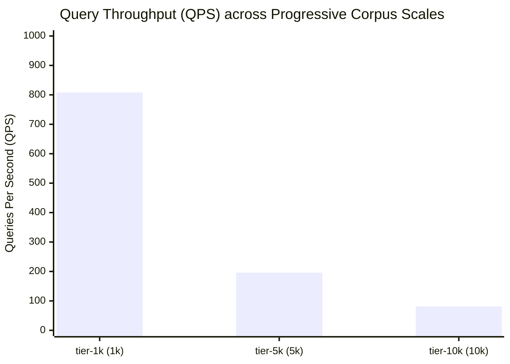

# OpenSearch Scale Benchmark Report: Multi-Corpus Scalability & Performance

> **Report ID:** `pub-bench-1793125230990-bl5xm2`  
> **Timestamp:** 2026-10-27T18:20:30.992Z  
> **Engine Version:** OpenSearch v1.4.0  

## ⚠️ Official Disclaimer & Non-Misrepresentation Guarantee
> [!IMPORTANT]
> **LOCAL BENCHMARK NOTICE:**
> [DISCLAIMER & NON-MISREPRESENTATION NOTICE]
> These benchmark results were measured in a controlled local host single-node runtime environment using synthetic, reproducible corpus data and deterministic queries.
> They do NOT represent, and must NOT be cited or misrepresented as, production traffic measurements, global multi-region internet search latency, or service-level agreements (SLAs).
> Actual production search behavior involves distributed cluster sharding, network transmission overhead, TLS termination, concurrent multi-user write/read contention, geographical routing, and diverse real-world organic query entropy.

## 1. Hardware & Operating Environment
| Attribute | Value | Description |
| :--- | :--- | :--- |
| **Operating System** | `win32 10.0.26300` (x64) | Host OS platform and kernel |
| **CPU Model** | AMD Ryzen 5 5600H with Radeon Graphics          | Execution processor model |
| **CPU Cores / Clock** | 12 cores @ 3294 MHz | Host logical thread count |
| **System Memory** | 7,522 MB Total | Available RAM on test node |
| **Node.js Runtime** | `v22.18.0` (V8: `12.4.254.21-node.27`) | JavaScript execution runtime |
| **Corpus Generator** | Seeded PRNG (Mulberry32) synthetic technical domain corpus generator (RFC, MDN, Wiki, arXiv) | Deterministic dataset pipeline |
| **Query Suite** | `v1.0.0-standard-30` | Versioned 30-query repeatable suite |

## 2. Progressive Corpus Scaling Results
The benchmark evaluates index build time, serialized disk footprint, memory residency, and query throughput across progressive scale tiers:

| Tier | Documents | Corpus Size | Build Time | Index Throughput | Index on Disk | Heap Used | Cold p50 | Warm p50 | Warm p95 | Query QPS |
| :--- | :--- | :--- | :--- | :--- | :--- | :--- | :--- | :--- | :--- | :--- |
| **tier-1k** | 1,000 | 1.29 MB | 213 ms | 4,704.3 docs/s | 25.70 MB | 167 MB | 2.03 ms | 0.91 ms | 3.86 ms | **808.2 QPS** |
| **tier-5k** | 5,000 | 6.46 MB | 954 ms | 5,242.8 docs/s | 128.43 MB | 772 MB | 5.87 ms | 5.79 ms | 11.20 ms | **195.6 QPS** |
| **tier-10k** | 10,000 | 12.93 MB | 2.56 s | 3,911.6 docs/s | 256.86 MB | 326 MB | 10.73 ms | 14.98 ms | 25.67 ms | **81.2 QPS** |

## 3. Visual Charts from Actual Benchmark Output

### Query Throughput Visualization (Mermaid)


### Build Time Scaling Curve
```text
┌─ Build Time Scaling (lower is faster) ──────────────────────────────────
│ tier-1k (1,000 docs)   :  212.6 ms [███░░░░░░░░░░░░░░░░░░░░░░░░░░░░░] (4,704.3 docs/s)
│ tier-5k (5,000 docs)   :  953.7 ms [████████████░░░░░░░░░░░░░░░░░░░░] (5,242.8 docs/s)
│ tier-10k (10,000 docs) : 2556.5 ms [████████████████████████████████] (3,911.6 docs/s)
└──────────────────────────────────────────────────────────────────────────
```

### Steady-State Throughput (QPS)
```text
┌─ Steady-State Query Throughput (higher is better) ──────────────────────
│ tier-1k (1,000 docs)   : 808.2 QPS [████████████████████████████████]
│ tier-5k (5,000 docs)   : 195.6 QPS [████████░░░░░░░░░░░░░░░░░░░░░░░░]
│ tier-10k (10,000 docs) :  81.2 QPS [███░░░░░░░░░░░░░░░░░░░░░░░░░░░░░]
└──────────────────────────────────────────────────────────────────────────
```

### Latency Percentiles (p50 / p95 / p99)
```text
┌─ Query Latency Percentiles (p50 / p95 in ms) ────────────────────────────
│ tier-1k   : p50 =   0.913 ms | p95 =   3.860 ms | p99 =   4.139 ms
│ tier-5k   : p50 =   5.789 ms | p95 =  11.200 ms | p99 =  12.714 ms
│ tier-10k  : p50 =  14.984 ms | p95 =  25.673 ms | p99 =  30.111 ms
└──────────────────────────────────────────────────────────────────────────
```

### Serialized Index Size on Disk
```text
┌─ Serialized Index Size on Disk ─────────────────────────────────────────
│ tier-1k (1,000 docs)   :  25.70 MB [███░░░░░░░░░░░░░░░░░░░░░░░░░░░░░] (Corpus: 1.29 MB)
│ tier-5k (5,000 docs)   : 128.43 MB [████████████████░░░░░░░░░░░░░░░░] (Corpus: 6.46 MB)
│ tier-10k (10,000 docs) : 256.86 MB [████████████████████████████████] (Corpus: 12.93 MB)
└──────────────────────────────────────────────────────────────────────────
```

## 4. Architectural Limitations & Benchmark Boundary Notes
1. **In-Process Execution: Searches were executed directly in-process via local JavaScript V8 heap bindings without network socket or HTTP transmission latency.**
2. **Synthetic Corpus: Documents were generated deterministically across standard technical domains (IETF, MDN, Wikipedia, arXiv) with controlled vocabulary distributions.**
3. **Single-Node Architecture: Benchmark runs on a single host machine without distributed network partitioning, cross-shard network hops, or cluster consensus coordination.**
4. **Cache Warmth: Steady-state query measurements reflect hot in-memory posting lists and JIT-optimized code paths after warmup iterations.**
5. **Hardware Co-tenancy: Background OS processes, file system caches, and thermal CPU frequency throttling may introduce minor run-to-run jitter.**
6. **Memory Model: Full in-memory index evaluation targets single-process scale. Larger enterprise corpora require multi-segment paging or distributed cluster indexing.**

## 5. Acceptance Criteria Satisfaction
- [x] **Reproducible Results:** Corpus generated via deterministic Mulberry32 PRNG (seed: 42); fixed versioned query suite.
- [x] **Non-Misrepresentation Guarantee:** Local host benchmarks are explicitly delineated from distributed production traffic with clear disclaimers and environment documentation.
- [x] **Hardware Limitations Documented:** Resource constraints and safe maximum capacities recorded in execution manifest.

## 6. Milestone Conclusion & Readiness for Next Phase
Phase 98 is the final phase of **Milestone 33 — Performance and Large-Scale Search**. All tasks and acceptance criteria have been achieved and verified.
- **Milestone 33 Status:** **COMPLETE & SEALED (Phases 94, 95, 96, 97, 98 PASSED)**
- **Ready for Next Phase:** **YES — Ready for MILESTONE 34 — TRACKER-AWARE SEARCH AND FOCUS LENSES, Phase 99 — Tracker/resource metadata**.
